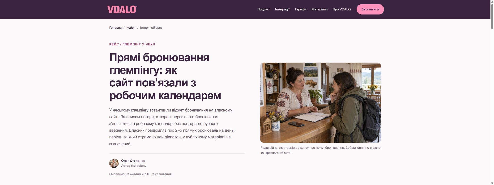

# Перенесення редакцій: підсумок перевірки

Дата: 23 жовтня 2026 року. Нижче — первинна перевірка staging. Після повторної перевірки й прямого погодження Костянтина пакет `84ac8f1` перенесений на основний домен. Фінальна перевірка обох середовищ: [release-review/RELEASE.md](release-review/RELEASE.md).

## Що перенесено

Усі 70 підготовлених редакцій: 16 статей, 6 кейсів, 28 місцевих довідок туристичного збору та 20 інших сторінок. Зміст, посилання, заголовки, описи, картки, авторство й структуровані дані узгоджені між собою. Статті зберігають справжні дати публікації; дата редакційного оновлення — 23 жовтня.

Текст розміщений у серверному HTML. Збережені читабельна колонка, фото з підписами, зміст, мобільна навігація, горизонтальна прокрутка таблиць і перенесення технічних прикладів. Пакет не підміняє існуючі інструменти або форми описовим текстом.

23 відкладені продуктові сторінки й усі 13 нових воронок не входять до цього пакета. Конфігурація сервера, CRM і платежів не змінювалася. Публічної обіцянки безкоштовного першого налаштування не додано.

## Результати

| Перевірка | Результат | Доказ |
| --- | --- | --- |
| Повний набір автоматичних тестів | 223/223 | `tests.txt` |
| Повтор у копії з LF | 223/223 | `lf-tests.txt`, `lf-build.txt` |
| Структуровані дані | 91/91 маршрутів, 0 помилок локального валідатора | `schema.txt` |
| Арифметика прикладів | 55 добутків і округлень | `tests/content-package.test.mjs` |
| Збереження форм | Адреси, поля, required/min/max, кнопки та інші атрибути збережено на всіх 70 сторінках | `BASELINE_FORM_CONTRACTS.json`, автоматичні тести |
| Відкладені сторінки | Повний HTML 36 маршрутів збігається з попереднім релізом після нормалізації платформних відмінностей | `BASELINE_EXCLUDED_ROUTES.json`, автоматичні тести |
| Локальна адаптивність | Усі 70 на фактичних ширинах 390, 768, 1440 px; дефект ширини 6 кейсів виправлений і перевірений повторно | `browser-responsive.json` |
| Staging: телефон і комп’ютер | Усі 70 на фактичних ширинах 390 і 1440 px: актуальний текст, один H1, метадані, canonical, robots, без горизонтального переповнення та виявлених несправних завантажених зображень | `staging-browser.json` |
| Staging: додаткові ширини | Усі 70 на 960 px, 6 вибраних шаблонів на 320 px | `staging-browser.json`, `staging-320.json` |
| Форма доступу | CTA відкриває діалог; порожнє надсилання дає українські помилки, заявка не створюється | `staging-form-validation.txt` |
| Cookies | Кнопка відкриває налаштування з окремими перемикачами; діалог закривається | `staging-cookie-settings.txt` |
| Мобільний зміст | Відкривається, посилання переводить до потрібного розділу; Wi-Fi payload збережений | `staging-mobile-contents.json` |
| Контраст прикладу коду після виправлення | На staging завантажений CSS `51a362491507`; текст `rgb(57,35,62)` на фоні `rgb(245,238,243)`, без переповнення на 390 px | `staging-code-contrast.json`, `staging-mobile-code-after.png` |
| Консоль Chrome | У доступному захопленому журналі помилок немає | `staging-console.json` |
| Захист середовищ | Основний сайт містить попередню редакцію. Staging вимагає авторизацію та повертає X-Robots-Tag: noindex, nofollow | `environment-check.json` |

Ширини визначені за `innerWidth`, а не лише параметрами емуляції. У журналі також залишено попередній діагностичний прохід на 260 px, який виник через різний масштаб браузера для origin. Він не рахується успішною перевіркою підтримуваних розмірів. Фінальний прохід 390 px охоплює всі 70 сторінок.

## Знайдено й виправлено

1. Мобільна сітка 6 кейсів розширювала сторінку через мінімальний розмір таблиці. Обмежено ширину колонок і додано коректну внутрішню прокрутку таблиць.
2. Контрольні хеші виключених сторінок залежали від CRLF/LF і платформного хешу статичних ресурсів. Порівняння зроблено переносним без виключення змісту сторінок.
3. У Wi-Fi статті глобальний стиль змінював фон блоку коду, лишаючи світлий текст. Обидва стилі тепер використовують світлу поверхню й темний текст; дочірній code успадковує колір. Повторно перевірено в мобільному Chrome на staging після доставки нового CSS. Усі 223 тести повторно пройшли у звичайній робочій теці та копії з LF.

## Межі підтвердження

- Реальних заявок і платежів у цьому завданні не створювали. Попереднє отримання заявок у Telegram підтвердив власник; нинішні перевірки підтверджують збереження форм, а не нову наскрізну доставку.
- Надсилання email-звіту PMS залишається недоступним; новий текст прямо це пояснює.
- Одеса лишається `noindex,follow` без розрахунку; спірні цінові межі Дніпра, Львова й Тернополя не вгадуються. У Яремчі уточнені назви категорій за формою ДПС, числові ставки не змінені.
- 10 замінених офіційних PDF прочитані через веб-інструмент; файл Поляни незалежно відкрити не вдалося. Оновлення тексту не прирівнюється до нової юридичної перевірки всіх ставок.
- Зовнішні Rich Results Test, GSC, GA4 DebugView і Clarity не перевірялися в цьому контентному завданні. Немає твердження про гарантоване індексування, позиції чи приріст трафіку.
- Збірка QR-інструмента успішна; її попередження про великі JS-чанки збережене в `lf-build.txt`. У цьому контентному оновленні його завантажувач не змінювали.

## Перегляд

Повний список: [STAGING_URLS.md](STAGING_URLS.md).

Приклади:

- [Оновлений кейс](https://staging.vdalo.tech/cases/direct-bookings-calendar)
- [Стаття Wi-Fi QR](https://staging.vdalo.tech/blog/qr-wifi-dlya-gotelyu)
- [Профіль Костянтина](https://staging.vdalo.tech/authors/kostiantyn-tripailo)

Основний сайт оновлено після погодження Костянтина та повторної перевірки staging. Обидва середовища містять `84ac8f1`; деталі й докази після релізу наведені в [release-review/RELEASE.md](release-review/RELEASE.md).
