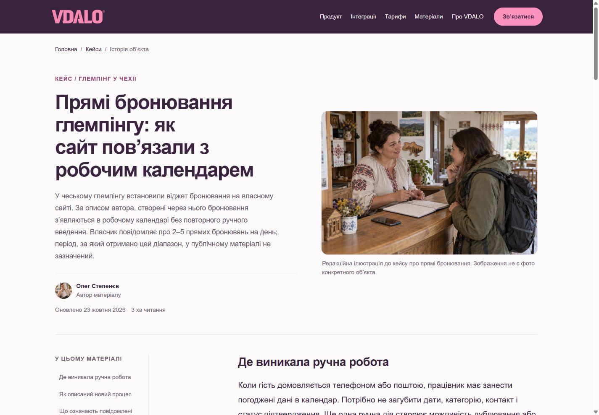
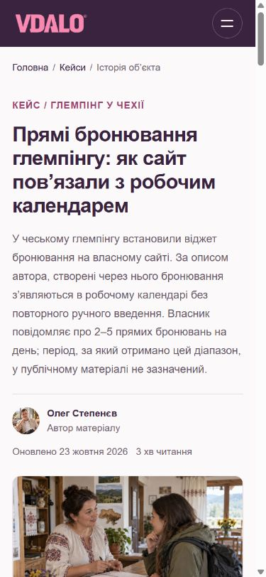

# Повторна перевірка та реліз пакета

Костянтин прямо погодив перенесення на основний домен після повторної успішної перевірки всіх 70 сторінок. Перевірений коміт: `84ac8f1e302a09310ce5c5aa96208c36b4e46bfb`. Попередній main: `85ea45cd65249a436e8e1c5cdc9b5a4f0fab1591`.

## До релізу

- [x] Повторно звірені віддалені гілки, diff і відсутність змін у серверній конфігурації.
- [x] 223/223 тести; 91/91 маршрутів локальної перевірки структурованих даних.
- [x] Усі 70 сторінок відкриті в Chrome на фактичних ширинах 1440 та 390 px: 140 записів, без помилок контрольних перевірок.
- [x] Заголовок, description, OG, canonical, robots і всі поля форм звірені з реальним серверним рендером перевіреного коміту. Переноси рядків H1 нормалізовані як пробіли, порядок ключів JSON не вважається зміною поля.
- [x] Валідація форми тестового доступу та форми обговорення процесу: українські повідомлення, email, згода. Створення реальних заявок не виконувалося.
- [x] Кнопка налаштувань cookies відкриває діалог із двома окремими категоріями.
- [x] Київ: 2 внутрішні гості × 2 доби = 138,35 грн у контрольній арифметиці.
- [x] Прибутковість: 10 номерів, 50%, тариф 1 000 грн, енергія 100 грн, OTA 40% і 15% = 150 000 грн виручки, 500 грн RevPAR, 126 000 грн залишку після двох статей.
- [x] QR для публічного URL створено, попередній перегляд готовий, PNG-кнопка активна.
- [x] Чекліст PMS: пройдені 7 кроків і 25 навчальних оцінок; для всіх «Підтверджено» отримано 100% оцінки й 100% покриття. Це перевірка інтерфейсу, не оцінка реального продукту. Створена лише локальна staging-чернетка «ТЕСТ VDALO QA»; очищення через нативне підтвердження не вдалося незалежно підтвердити браузерним інструментом.
- [x] У доступному журналі консолі Chrome помилок немає.
- [x] Перед релізом повторно перевірено, що main і staging не змінилися стороннім комітом. Виконано звичайний fast-forward push staging → main, без force.

## Після релізу

- [x] Сервер застосував реліз: нові тексти та CSS `51a362491507` фактично доступні на основному домені.
- [x] Усі 70 сторінок повторно відкриті на 1440 і 390 px: 140 записів, без помилок контрольних перевірок.
- [x] GET усіх 70 сторінок: 200, правильні заголовки, description, canonical і robots. Додатково HEAD 76 ресурсів, включно з адресами lazy-зображень із браузерного проходу: усі 200. Три старі QR-редиректи повертають 308 і зберігають UTM. Robots не закриває весь production; sitemap містить усі індексовані редакції, без staging-адрес.
- [x] Окремо перевірено доступність 44 збережених маршрутів: 23 відкладені продуктові, 13 нових воронок та 8 попередніх квізів/коротких адрес. Вони не отримали контентного адаптера цього пакета; відповіді 2xx/3xx.
- [x] CTA заявки й обговорення відкривають діалоги. На телефоні перевірено trial/email/згоду, на комп’ютері — валідацію форми обговорення. Реальні заявки не надсилалися.
- [x] Cookies відкриваються на комп’ютері й телефоні, без переповнення. Наявний вибір двох категорій збережений; у цьому релізі його не змінювали.
- [x] Мобільний зміст Wi-Fi статті відкривається й прокручує до потрібного заголовка; технічний payload збережений, темний текст читабельний.
- [x] На production Київ: 2 внутрішні + 1 в’їзний гість × 2 доби = 311,29 грн у контрольній арифметиці. Прибутковість: 126 000 грн у тому самому навчальному сценарії. QR для публічної адреси створений, preview видно, PNG активний. Інтерактивний PMS-чекліст завантажився зі збереженою попередньою чернеткою браузера; її не змінювали. Повний прохід 7 кроків виконаний на staging.
- [x] У доступному журналі production-консолі Chrome помилок немає. Збережені скріншоти комп’ютерної/мобільної версій кейсу, форм, cookies і прикладу коду.
- [x] Main і staging вказують на однаковий `84ac8f1`. Staging зберігає Basic Auth і HTTP `noindex, nofollow`.

## Висновок

Контентний пакет опублікований на основному домені. Повторний огляд staging і перевірки після релізу не виявили блокувальних проблем. Докази: `staging-browser.json`, `production-browser.json`, `production-http.json`, `result.json`, `remote-branches.txt` і відповідні UI-сценарії поруч із цим файлом. Усі 70 повних production-посилань — у [PRODUCTION_URLS.md](PRODUCTION_URLS.md).

Незавантажені під час початкового перегляду lazy-зображення не позначалися зламаними. Їхні адреси перевірені окремими HEAD-запитами. Контроль усіх сторінок включав DOM, метадані, форми та ширину документа; скріншоти й ручні інтерактивні проходи збережені для ключових шаблонів. Це не твердження про ручний перегляд кожного пікселя всіх сторінок або про підтримку кожного браузера.

GTM, GA4 та Clarity присутні у DOM після раніше наданої згоди. Отримання подій у DebugView/Tag Assistant/Clarity-панелі в цьому контентному релізі незалежно не підтверджувалося. Наявність тегів не вважається доказом доставки подій. Прямого доступу до серверної телеметрії немає; стан підтверджений публічними HTTP-відповідями й браузером.

Відкочування: за підтвердженого блокувального збою припинити реліз, зафіксувати URL і симптом. Попередній робочий main відомий; серверний механізм відкату й конфігурація залишаються у відповідальної команди. Нових міграцій бази, залежностей або серверних параметрів цей пакет не потребує.

Ці перевірки не підтверджують доставку нової заявки в Telegram/CRM, отримання подій GA4/Clarity, фактичну індексацію або юридичну чинність кожної місцевої ставки. Поточні обмеження email-звіту PMS та окремих довідок лишаються описаними в основному `REVIEW.md`.
